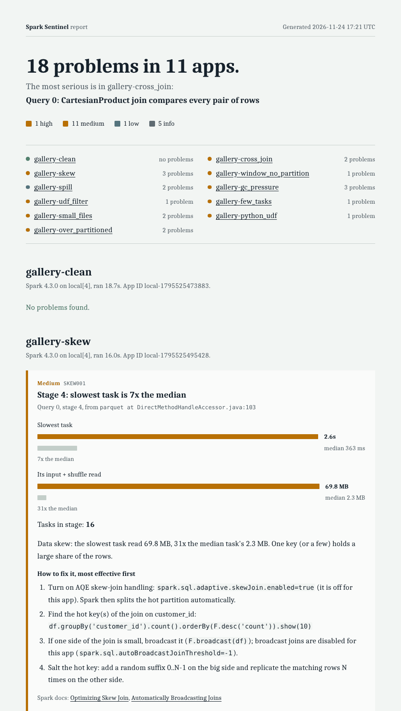

# Spark Sentinel

[](https://pypi.org/project/spark-sentinel/)
[](https://pypi.org/project/spark-sentinel/)
[](https://github.com/r4otxrhs3/spark-sentinel/actions/workflows/ci.yml)
[](https://github.com/r4otxrhs3/spark-sentinel/blob/main/LICENSE)

**Find performance problems in Apache Spark jobs from their event logs, and learn how to fix
them.** Skew, spill, small files, missed broadcast joins, row-by-row Python UDFs, idle cores and
more, each traced to the stage and SQL query that caused it, with a concrete fix and a link to
the Spark documentation behind it.


- **No code changes.** It reads the event log Spark already writes (the same file the History
  Server uses).
- **No cluster needed.** Runs on your laptop, on logs from anywhere: local runs, Databricks, EMR,
  Kubernetes, Spark 3.5 and 4.x.
- **Made for CI.** `--fail-on high` turns a performance regression into a failed build.

## Install

```bash
pipx install spark-sentinel        # or: pip install spark-sentinel
uvx spark-sentinel analyze ...     # or run it without installing
```

Python 3.11+. You don't need Spark or Java to run Sentinel, only an event log.

## Quick start

1. Turn on event logging for your Spark job:

   ```python
   spark = (
       SparkSession.builder.config("spark.eventLog.enabled", "true")
       .config("spark.eventLog.dir", "file:///tmp/spark-events")
       .getOrCreate()
   )
   ```

   On a cluster, logs are usually already on: look where `spark.eventLog.dir` points and copy
   the log to your machine.

2. Analyze it:

   ```bash
   sentinel analyze /tmp/spark-events                    # every log in the folder
   sentinel analyze /tmp/spark-events -f html -o report.html
   ```

3. Small local runs finish in seconds, so their problems are small too. Use the laptop profile
   to see them: `sentinel analyze /tmp/spark-events --profile laptop`.

The HTML report is one self-contained file that works offline, in light and dark mode:



## What it finds

| Rule | Problem | Based on (Spark docs) |
|---|---|---|
| `SKEW001` | One task takes far longer than its siblings; tells data skew from compute skew | [Optimizing Skew Join](https://spark.apache.org/docs/latest/sql-performance-tuning.html#optimizing-skew-join) |
| `SPILL001` | Tasks spill to disk for lack of execution memory | [Memory Usage of Reduce Tasks](https://spark.apache.org/docs/latest/tuning.html#memory-usage-of-reduce-tasks) |
| `GC001` | Tasks spend a large share of their time in garbage collection | [Garbage Collection Tuning](https://spark.apache.org/docs/latest/tuning.html#garbage-collection-tuning) |
| `FILES001` | A write produces many small files | [Coalesce Hints](https://spark.apache.org/docs/latest/sql-performance-tuning.html#coalesce-hints) |
| `PART001` | Too many shuffle partitions for the data | [Coalescing Post Shuffle Partitions](https://spark.apache.org/docs/latest/sql-performance-tuning.html#coalescing-post-shuffle-partitions) |
| `PART002` | Too few shuffle partitions: huge tasks | [Tuning Partitions](https://spark.apache.org/docs/latest/sql-performance-tuning.html#tuning-partitions) |
| `PAR001` | A long stage with fewer tasks than cores | [Level of Parallelism](https://spark.apache.org/docs/latest/tuning.html#level-of-parallelism) |
| `PLAN001` | A Python UDF in a filter blocks pushdown into the file scan | [Arrow Python UDFs](https://spark.apache.org/docs/latest/api/python/tutorial/sql/arrow_pandas.html#arrow-python-udfs) |
| `PLAN002` | A join without an equality key: cartesian or nested-loop join | [Join Strategy Hints](https://spark.apache.org/docs/latest/sql-performance-tuning.html#join-strategy-hints) |
| `PLAN003` | All of a query's data goes through one task (e.g. a window without `partitionBy`) | [Avoid computation on single partition](https://spark.apache.org/docs/latest/api/python/tutorial/pandas_on_spark/best_practices.html#avoid-computation-on-single-partition) |
| `PLAN004` | A sort-merge join where one side was small enough to broadcast | [Automatically Broadcasting Joins](https://spark.apache.org/docs/latest/sql-performance-tuning.html#automatically-broadcasting-joins) |
| `PLAN005` | A Python UDF runs row by row instead of in Arrow batches | [Arrow Python UDFs](https://spark.apache.org/docs/latest/api/python/tutorial/sql/arrow_pandas.html#arrow-python-udfs) |
| `CONF001` | Settings that switch off Spark's automatic optimizations (info) | [Adaptive Query Execution](https://spark.apache.org/docs/latest/sql-performance-tuning.html#adaptive-query-execution) |

The [rule catalog](https://github.com/r4otxrhs3/spark-sentinel/blob/main/docs/rule-catalog.md)
maps every section of Spark's tuning guides to the symptom Sentinel looks for, including what's
planned next and what an event log can't show. `sentinel rules` lists the rules with their
thresholds.

Every rule is tested against a [gallery of deliberately bad Spark jobs](https://github.com/r4otxrhs3/spark-sentinel/tree/main/lab/gallery),
run on Spark 3.5 and 4.3: each job must trigger its rule, and a clean job must trigger none.

## Use it in CI

```bash
sentinel analyze path/to/eventlogs --fail-on high -f md -o sentinel.md
```

| Exit code | Meaning |
|---|---|
| 0 | Analysis ran; nothing at or above `--fail-on` (default: never fail on findings) |
| 1 | A finding at or above `--fail-on` |
| 2 | Bad options or config |
| 3 | An event log couldn't be read, or a rule crashed |

Settings can live in a `sentinel.toml` next to your code (command-line options override it):

```toml
profile = "default"          # or "laptop" for small test jobs
fail_on = "high"
format  = "md"
ignore  = ["CONF001"]

[thresholds.SKEW001]
min_time_lost_ms = 60000
```

## Compare two runs

`sentinel diff` compares a baseline run (say, from `main`) with a new one (from a pull
request) and explains what got slower:

```console
$ sentinel diff base-run/ pr-run/ --profile laptop
SLOWER  Query 0: 1.5x slower (3.9s → 6.0s): the broadcast join became a sort-merge join, which adds
        2 shuffles (after spark.sql.autoBroadcastJoinThreshold changed from the default to -1)
        writes report/revenue
        task time 6.0s → 14.3s · shuffle 7.0 KB → 26.3 MB
        Plan (- before, + after):
          -   +- * BroadcastHashJoin Inner BuildRight
          +   +- * SortMergeJoin Inner
          ...

Settings changed
  spark.sql.autoBroadcastJoinThreshold: (default) → -1

New problems
  MED   PLAN004  Query 0: sort-merge join where one side is only 3.1 MB
```

- **Queries are matched by what they do, not by their IDs.** Plans are normalized
  (expression IDs, operator numbers and paths removed), then matched by plan, then by what
  they read and write. Adding a query doesn't throw off the rest.
- **Noise is filtered.** A change counts only if it crosses both a percentage and an absolute
  threshold (laptop profile: 30% and 1 s or 8 MB; default: 25% and 30 s or 256 MB).
- **A slowdown is *confirmed* only if something deterministic changed with it**: the join
  strategy, a Python UDF, the number of shuffles, spill, data volume or a related setting.
  A slowdown with no visible cause is reported as possible noise and doesn't fail
  `--fail-on slower`. (Wall time is noisy: a cold first run of an unchanged job measured 1.7x
  slower.)
- **New and fixed problems**: the rules run on both runs, so a pull request that introduces
  a problem shows up even when it isn't slower yet.

```bash
sentinel diff baseline/ new/ --fail-on slower --fail-on high -f md -o diff.md
```

Each side is an event log, a folder holding one run's log, or an app ID from
`sentinel apps`. Thresholds can be changed with `--threshold min_time_ms=5000` or in
`sentinel.toml`:

```toml
[diff]
min_change_pct = 25
min_time_ms = 10000
min_bytes = 268435456
```

To try it, [`lab/diff/sales_report.py`](https://github.com/r4otxrhs3/spark-sentinel/blob/main/lab/diff/sales_report.py)
runs a small report job plus one-line "pull requests" that break it.

## Commands

| Command | What it does |
|---|---|
| `sentinel analyze PATH...` | Read logs (if given) and report problems: `--format text\|md\|html\|json`, `--profile`, `--select`, `--ignore`, `--threshold RULE.name=value`, `--fail-on` |
| `sentinel diff BASELINE NEW` | Compare two runs: queries slower or faster and why, settings changed, new and fixed problems: `--format text\|md\|json`, `--fail-on slower\|<severity>`, `--threshold name=value` |
| `sentinel ingest PATH` | Parse logs once into a local Parquet warehouse (`.sentinel/`) |
| `sentinel sql "SELECT ..."` | Query the stored tables (`tasks`, `stages`, `jobs`, `sql`, `executors`, `config`, ...) with DuckDB |
| `sentinel apps` | List ingested apps |
| `sentinel rules` | List rules and their thresholds |
| `sentinel inspect PATH` | Show how a log is stored and count its events |

## How it works

```
event log ─▶ reader ─▶ parser ─▶ Parquet tables ─▶ DuckDB SQL ─▶ rules ─▶ report
 (plain,      (streams   (tasks, stages,   (parse once,      (one SQL query    (text, md,
  zstd, gzip,  lines)     jobs, sql plans,  query many        + diagnosis       html, json)
  rolled)                 executors, ...)   times)            per rule)
```

Every slow task can be traced through its stage and job to the SQL query and physical plan that
produced it, which is how findings name the join key, the UDF or the `repartition(500)` behind a
problem.

## Limitations (v0.1)

- Reads local files. Copy logs from S3, HDFS or DBFS first.
- Logs compressed with Spark's `lz4`, `lzf` or `snappy` codecs aren't supported yet (`zstd`,
  Spark's default, and `gzip` are).
- Per-operator SQL metrics (rows per plan node, files read) aren't parsed yet; the rules that
  need them are [planned](https://github.com/r4otxrhs3/spark-sentinel/blob/main/docs/rule-catalog.md).
- Thresholds default to production-sized jobs; use `--profile laptop` for small runs.
- `sentinel diff` compares one app with one app, from a single run each. A change inside a
  Python UDF's code doesn't change the plan, so a slowdown it causes shows as unconfirmed.

## Contributing

New rules are welcome. [CONTRIBUTING.md](https://github.com/r4otxrhs3/spark-sentinel/blob/main/CONTRIBUTING.md)
walks through adding one, from the gallery job that reproduces the problem to the tests that
keep it free of false alarms.

## License

[Apache License 2.0](https://github.com/r4otxrhs3/spark-sentinel/blob/main/LICENSE)
